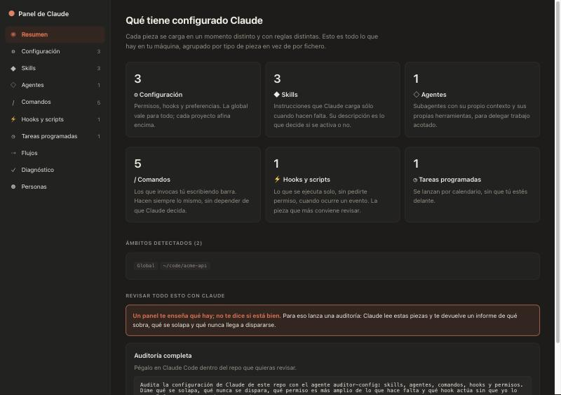
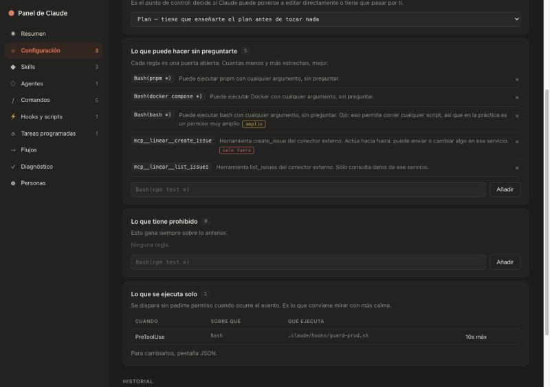
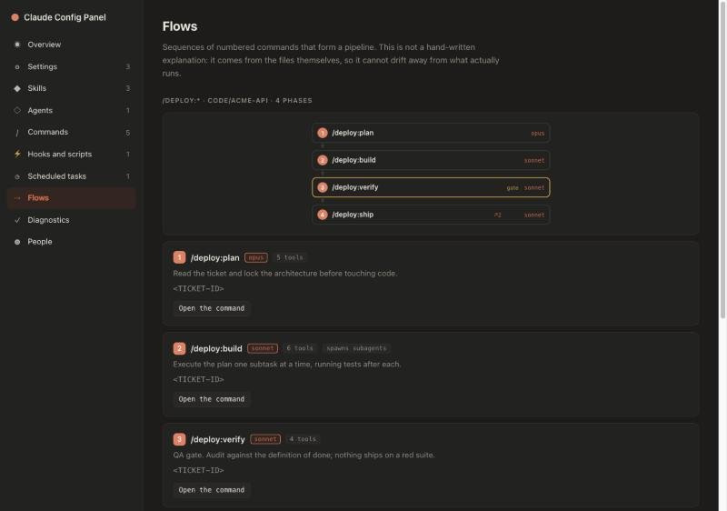
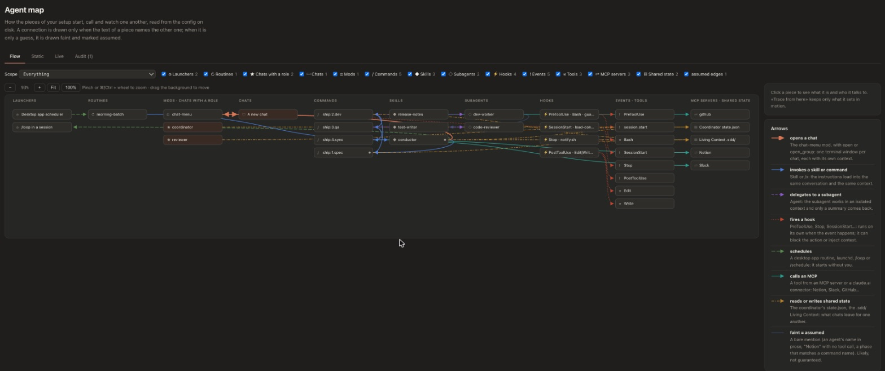
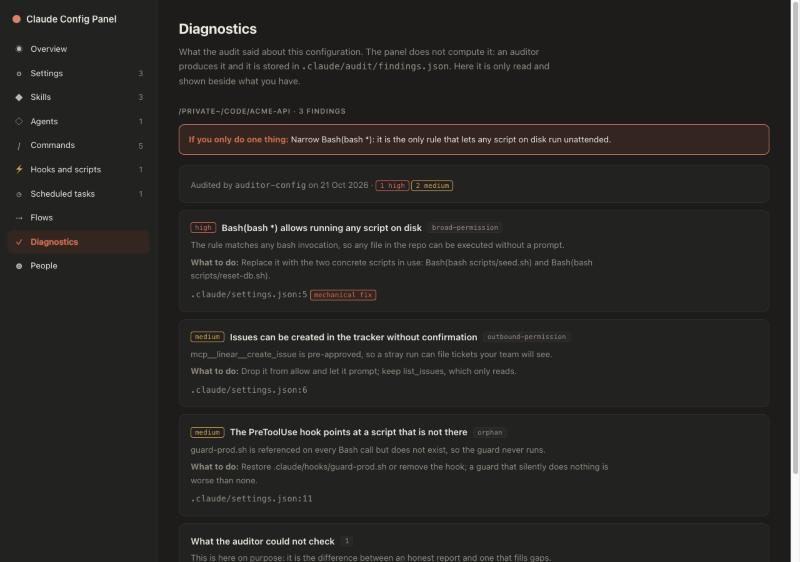

<div align="center">

# Claude Config Panel

**See everything Claude Code is configured to do — and what runs on its own.**

Your Claude setup is scattered across `~/.claude` and a `.claude/` folder in every repo.
There is no single screen that shows you all of it. This is that screen.

[](https://www.npmjs.com/package/claude-config-panel)
[](https://github.com/Galan9999/claude-config-panel/actions/workflows/ci.yml)
[](LICENSE)
[](package.json)
[](package.json)
[](test)

</div>

```bash
npx claude-config-panel
```

Open <http://127.0.0.1:7337>. Node 18+. Nothing to install, no dependencies, runs only on your machine.

No Node? **[Try it in your browser](https://claude-config-panel.vercel.app)**: you pick the folders, they are
read in the tab, and nothing is sent or saved anywhere.

<div align="center">
  
</div>

---

## Why

`/config` and `/permissions` cover a slice of it, and only in the terminal. Everything else means
opening JSON files by hand. So three questions stay unanswered:

- **What do I actually have?** Settings, skills, agents, commands, hooks and scheduled tasks, global
  and per repo, in one place.
- **What does this rule really allow?** `Bash(node *)` reads as harmless. It lets Claude run any
  script on your machine.
- **What runs without me?** Hooks and scheduled tasks act while you are not looking. That is the part
  of your configuration that deserves the most attention and gets the least.

---

## What it does

### Explains every permission in plain words

Each rule is translated, and the ones that are wider than they look get flagged.

| Rule | What the panel says |
|---|---|
| `Bash(git *)` | Can run git with any argument, without asking. |
| `Bash(node *)` | …**Careful: that allows running any script**, so in practice it is a very broad grant. → `broad` |
| `mcp__…__slack_send_message` | Acts outward: can send or change something in that service. → `outbound` |

<div align="center">
  
</div>

### Says why a rule should be the shape it is

Every rule carries a *why it is like this, and what else it could be* panel: which family the
command belongs to, what the prefix still admits once you look past the program's name, whether the
rule is in the right file, and the narrower rule that does the same job.

| Rule | Verdict | Because |
|---|---|---|
| `Bash(find *)` | `reconsider` | `find . -exec <anything> {} \;` runs that anything. It is an interpreter rule wearing a different name. |
| `Bash(npm run *)` | `narrow it` | Grants whatever `package.json` says those scripts mean today, and the repo can change them. |
| `Bash(gh pr *)` | `narrow it` | Covers `gh pr view` and, in the same breath, `gh pr merge` and `gh pr close`. |
| `Bash(ls *)` | `redundant` | Plain read-only commands never needed a rule. |
| `Bash(npm test)` | `reasonable` | No wildcard: it approves this command line and nothing adjacent. |

The **Permissions guide** view holds the reference behind those verdicts — how a Bash pattern is
matched (a prefix string, no flag analysis), what `allow` / `ask` / `deny` / `defaultMode` /
`additionalDirectories` each do, the command families, and six questions to ask before adding a
rule.

### Says who decides in auto mode

A permission rule is not the last word. In auto mode the prompt never reaches you: the action goes
to a classifier on Anthropic's servers, which decides from rules of its own. The settings view spells
that out next to the mode selector — whether this file can grant `"auto"` at all (only
`~/.claude/settings.json`, a managed policy or `--permission-mode auto` can; the same value in a
repo's settings is ignored), whether `autoMode.classifyAllShell` is suspending every `Bash` rule,
and whatever `autoMode.{environment, allow, soft_deny, hard_deny, deny}` the file adds.

### Surfaces what runs on its own

Hooks and scheduled tasks in one table: what triggers them, what they run, with what time limit.
This is how you find out you have two Prettier hooks firing on every single write.

### Lists your mods

A mod is a change Claude Code makes to its own interface or behaviour: a panel, a band, a status
line entry, a toast, a slash command, a hook on tool calls. They live in `~/.claude/mods/<name>/`
and run as you. The **Mods** section reads each folder (`plugin.json`, `hooks/hooks.json` and the
hooks module) and shows its description, version, whether your settings load it, the commands, the
tools for the model and the hook events it registers, what it draws on, and whether it runs
processes, touches files or calls a model. It reads names from the source; it never runs a mod and
it does not edit one.

### Separates MCP servers and routines

**MCP servers** has its own section, grouped by where each one is declared (`~/.claude.json`,
`.mcp.json`, a project): the command or URL and the *names* of the secrets it needs, never their
values.

**Routines** gathers everything that fires on a schedule, each with its definition: the local ones
in `~/.claude/scheduled-tasks`, the cloud ones from your claude.ai account (name, cron, state, next
and last run, connectors and prompt, redacted), and session loops. `/loop` and session cron jobs
live in a running session's memory, not in a file, so only the ones that were active when the
snapshot was generated can be shown. Cloud routines are not on disk either: the artifact edition
shows them when whoever generates the snapshot adds them.

### Draws your command pipelines

Nothing to declare or install: it is a naming convention. **Two or more files in the same commands
folder whose name starts with `<number>.`** are read as the phases of one process. The number only
sets the order — they need not be consecutive nor start at 1, so you can leave gaps for phases you
add later.

```
.claude/commands/deploy/
  1.check.md
  2.build.md
  3.ship.md
```

That is enough for the panel to render `/deploy:*` as an SVG diagram generated from the files
themselves — no Mermaid, no CDN — showing each phase's model, which subagents it spawns, and **how
many actions it can take outside your machine without asking**. No folder is hardcoded; it works
with whatever you name yours.

If your commands are not a sequence, the section tells you so and explains the convention. It never
invents a flow that is not there.

<div align="center">
  
</div>

It also flags **drift**: commands referenced in documentation that no longer exist, and paths
mentioned that are not there. Documentation that describes a command nobody can run is a trap, and
this finds it the day it breaks instead of months later.

### Maps how your agents talk to each other

The **Agent map** draws every piece that can start, call or watch another one — commands, skills,
subagents, hooks, mods, routines, MCP servers, chats with a role — and the arrows between them, read
from the files themselves. One arrow style per kind of interaction:

| Arrow | Means |
|---|---|
| opens a chat | a mod opens a new session in its own window (`open`, `open_group`) |
| invokes | `/x` or `Skill(x)`: the instructions load into the same context |
| delegates | `subagent_type: x`: a subagent works in its own context and returns a summary |
| fires a hook | a hook runs on an event or watches a tool, and can block or inject context |
| schedules | a desktop routine, launchd, `/loop` or `/schedule` starts it without you |
| calls an MCP | `mcp__server__tool`: Notion, Slack, GitHub… |
| shared state | a coordinator's `state.json` or a `.sdd/` folder the phases leave for one another |

An arrow is drawn only when the text says it in a form Claude Code acts on. When it rests on a bare
mention — an agent's name in prose, "Notion" with no tool call — it is drawn faint and marked
**assumed**. Four tabs:

- **Flow** — only what interacts, left to right. *Trace from here* keeps what one piece sets in motion.
- **Static** — every piece, one column per kind.
- **Live** — the chats running now, with their role and phase, if a coordinator keeps a
  `.sdd/_conductor/state.json` in one of the scanned projects (or `--sdd-state <file>`). Read-only.
- **Audit** — broken `/ns:cmd` references, unknown `subagent_type`, calls into a repo the caller never
  loads, names shadowed between global and a project, subagents nothing reaches (or only prose
  does), hook matchers that match no tool, routines that will not run.

Filter by kind and by **scope**: everything, global only, one repo, or a repo *as Claude sees it
there* (global + that repo). Zoom with a pinch or ⌘/Ctrl + wheel, drag to move.

<div align="center">
  
</div>

### Shows who built what

Per piece: who created it and when, who touched it since, how many lines each commit changed, and a
link to the commit. There is a profile per person with everything they created and everything they
touched afterwards.

It merges the same human across identities — work email, GitHub's
`12345+user@users.noreply.github.com`, the `user@MacBook-Air.local` of an unconfigured laptop — and
shows you which identities it merged, so you can spot a bad merge instead of trusting it.

For anything outside git — `~/.claude` is not a repo, `settings.local.json` files are gitignored —
it says so instead of inventing an author from a file timestamp.

### Tracks whether a skill changes anything

A skill that never fires is dead weight. A skill that fires and changes nothing is worse, because
it reads like coverage. `claude plugin eval` answers both by running each case twice — with the
skill and without it — and the **delta** between the arms is the only number that means something.
A case that passes in both arms is measuring the base model.

The **Evals** tab finds every bench on disk (a folder with `.claude-plugin/plugin.json` and an
`evals/` directory — a `.claude/` folder is not a plugin, so the bench lives outside the repo and
symlinks the skill in rather than copying it) and shows, per case: score with, score without, the
delta, and how many runs actually invoked the skill. It separates the two failure modes: a low
score means the skill is wrong, `0/3` fired means it never ran.

| Case | with | without | Δ | fired |
|---|---|---|---|---|
| `1-positivo-contencion` | 1.00 | 0.00 | **+1.00** | 3/3 |
| `2-negativo-rojo-real` | 1.00 | 0.33 | +0.67 | 0/3 — correct: it should stay quiet |

It also costs the next run out of that bench's own history rather than a guess, flags a case with no
grader and a symlink that no longer resolves, and lists which skills have a bench and which do not.
Each skill's own page carries its delta, which is where it matters: when you are deciding whether
to keep, rewrite or delete it.

#### Agents too, with three rules that are not the skill ones

A bench can measure a subagent, and the panel reads those the same way — but getting one to run at
all turns on three things that cost real money to discover:

**The agent file has to be a copy, not a symlink.** The opposite of the rule for skills. A symlink
under `agents/` is silently not loaded: the plugin still resolves, the suite still runs, and every
case scores zero exactly as if the agent had failed its own rubric. The only trace is in the
model's own words — `Available agents: claude, Explore, general-purpose, …`, with your agent
missing. The panel flags a symlinked agent as **not loaded**, and because a copy goes stale it
hashes both files and flags a **stale copy** when the bench holds an older version than the one
you are reading.

**The dispatch name carries the plugin prefix** — `my-bench:code-reviewer`, not `code-reviewer`.
The bare name fails with `Agent type not found`, and the model will decline to substitute a
generic agent rather than pass it off as yours.

**Run it with `--ablation none`.** The baseline arm has no plugin, so it cannot dispatch your agent
even in principle: its score is zero every time and the Δ measures the absence of the plugin, not
the agent. Without a baseline the score is read in absolute, and the panel labels it `no baseline`
rather than the `no Δ` it shows for a bench that has genuinely never been compared.

What is worth measuring also differs. For a skill you measure the trigger, because the model
decides whether to load it. An agent dispatched by a slash command never faced that decision, so
the `tool_used: Agent` grader is a check that it really ran, not a metric — and the score belongs
on what the agent's contract adds that the base model lacks.

### Reads your audits, next to what they are about

Point an auditing agent at a scope, have it write its report, and the panel shows each finding
beside the piece it concerns. Pieces with findings are marked in the listings, and a finding that
names a piece without living in its file is cross-referenced to it.

Reports live in `~/.claude/audits/<scope-slug>/<timestamp>.json` — **outside** the configuration
they are about. A report is an opinion about the config, not part of it: inside the repo it becomes
one more piece to audit, one more thing to gitignore or commit, and the next run overwrites the
last. The **Auditor** tab lists every scope the panel can see, audited or not, with its run history,
and keeps reading an older in-repo `.claude/audit/findings.json` so nothing already written is lost.
Scopes are keyed by the folder that owns the `.claude`, so a monorepo package like `apps/web` gets
its own audit rather than disappearing behind the repo it sits in.

A report can also carry **questions**: the things no amount of file-reading settles. A permission is
not wrong for being wide, it is wrong when nothing you do needs it that wide — and only you know
which. Each question names the exact rule, says what the answer decides, and offers the plausible
answers. The tab hands you a prompt that walks them one at a time and opens a PR with whatever you
agreed to.

No automatic patches and no automatic PRs. A patch that applies itself invites you to accept it
without reading it, which is the opposite of the point.

<div align="center">
  
</div>

> The screenshots show a sample configuration, not a real one.

### Lets you edit

Markdown rendered, JSON validated, every save backed up first.

---

## Usage

```bash
npx claude-config-panel                  # scan the usual project folders
npx claude-config-panel ~/my-repos       # scan a specific folder
```

| Option | What it does |
|---|---|
| `--port <n>` | Port to listen on (default 7337) |
| `--depth <n>` | How deep to look for `.claude/` folders (default 5 — enough for `<repo>/apps/<package>`) |
| `--worktrees` | Include linked worktrees, skipped by default because they duplicate their repo's config |
| `--sdd-state <file>` | The SDD coordinator's `state.json` for the agent map's live view (default: the first scanned project with `.sdd/_conductor/state.json`; also `CCP_SDD_STATE`) |
| `--help` | Usage |
| `CLAUDE_CFG_ROOTS=/a:/b` | Folders to scan, via environment variable |

With no arguments it looks for projects with a `.claude/` folder in the usual places (`~/code`,
`~/dev`, `~/projects`, `~/Desktop`, `~/Documents`…). Ctrl+C to stop.

The first time, the panel opens on **Sources**, where you choose what it reads:

- **Everything on this computer** — scans your whole home folder (skipping `Library`, caches,
  `node_modules` and worktrees), then you untick the projects you do not want.
- **Only the folders I choose** — one path per line.
- **Let Claude Code find them** — a prompt to paste into Claude Code that lists the folders holding
  configuration and what each has, without opening or changing anything.

Each project shows what it holds before you include it. The choice is kept in your browser and put
back when the server restarts; nothing is written to disk.

---

## Security

> [!IMPORTANT]
> This reads **and writes** your Claude configuration. Every save leaves a copy in
> `~/.claude/backups/config-dashboard/` first, but it is worth knowing before you start editing.

- **Listens on 127.0.0.1 only.** Never exposed to the network.
- **Checks where every request comes from.** Binding to localhost is not protection from your
  browser: any open website can fire requests at it. With `content-type: text/plain` that would be a
  simple request, no preflight, and the write would land even though the attacker cannot read the
  response — and the first piece in the inventory is `~/.claude/settings.json`, where a hook runs by
  itself in your next Claude session. So `Host` is validated (which also closes DNS rebinding),
  `Origin` is validated, and `application/json` is required, forcing a preflight.
  Regression tests live in [`test/server.test.mjs`](test/server.test.mjs).
- **Writes only to config files found during the scan.** Any other path is rejected.
- **Serves static files from `ui/` with no subfolders and no `..`**, so there is no path traversal.
- **Validates JSON before writing.** A malformed file never reaches disk.

Do not expose it beyond your own machine: it reads your Claude configuration, which can hold paths,
connector tokens and the contents of your scheduled tasks.

Thanks to **Lluís Filella** for catching the unauthenticated `POST`.

---

## The findings format

For an audit to be worth more than a read-through, its output needs a contract:
[`schema/findings.schema.json`](schema/findings.schema.json), validated by
[`src/findings.mjs`](src/findings.mjs).

<details>
<summary>Example report</summary>

```json
{
  "version": 1,
  "generatedAt": "2026-10-21T16:40:00.000Z",
  "tool": "auditor-config",
  "scope": { "path": "~/repos/backend", "kind": "repo" },
  "summary": "Drop Bash(bash *) from allow.",
  "findings": [{
    "id": "wildcard-bash-permission",
    "severity": "alta",
    "category": "permiso-amplio",
    "title": "Bash(bash *) allows running any script",
    "path": ".claude/settings.local.json",
    "line": 4,
    "what": "The rule lets any file be executed.",
    "proposal": "Replace it with the three concrete invocations actually in use.",
    "autofix": { "kind": "quitar-permiso", "file": ".claude/settings.local.json", "rule": "Bash(bash *)" }
  }],
  "notChecked": []
}
```

</details>

Validation is strict on purpose: whatever produces this is a language model or a third-party tool.
Two rules that are not cosmetic:

- **`id` must be stable across audits.** That is what decides whether a finding opens a new ticket or
  already has one.
- **A `proposal` starting with "review" is rejected.** It has to say what to do.

The format does not depend on this panel. Any auditor can emit it, and `cc-audit --format json` is a
candidate for an adapter.

---

## Development

No dependencies, runtime or dev. Everything it uses ships with Node: the server is `node:http` and
the tests are `node:test`.

```bash
git clone https://github.com/Galan9999/claude-config-panel
cd claude-config-panel
npm start      # run the panel
npm test       # 185 tests
```

<details>
<summary>Project layout</summary>

```
bin/claude-config-panel.mjs   CLI entry point
src/
  cli.mjs        Arguments, help, startup message
  paths.mjs      ~/.claude paths
  fsutil.mjs     Tolerant reads, frontmatter, script docs
  git.mjs        GitHub remote, repo root, worktree detection
  history.mjs    Authorship and changes, via git log
  flows.mjs      Numbered command pipelines and drift detection
  findings.mjs   Audit findings schema and cross-referencing
  audits.mjs     The audit store in ~/.claude/audits: runs, history, slugs
  evals.mjs      Eval benches, per-case deltas, coverage and run cost
  discover.mjs   Filesystem walk and piece catalogue
  mods.mjs       ~/.claude/mods, through the artifact scanner's reader
  server.mjs     HTTP routes, saving, backups
ui/
  index.html     The page
  style.css      Palette, with dark mode
  app.js         Navigation, listings, detail, editing
  markdown.js    Markdown renderer
  permissions.js Translates a permission rule into a sentence
  advice.js      Why that rule, and the narrower one that would do
  util.js        HTML escaping and helpers
  mods.js        Reads what a mod registers (shared with the artifact scanner)
test/            Tests for the pure functions and the HTTP contract
```

</details>

The interface lives in real `.html`, `.css` and `.js` files served as static assets.
`ui/markdown.js`, `ui/permissions.js` and `ui/advice.js` are DOM-free ES modules, so the Node tests
import exactly the same code the browser runs.

## The artifact edition

`artifact/` is a version that runs as a page, without Node — [hosted on Vercel](https://claude-config-panel.vercel.app),
where nothing is saved, or as a claude.ai artifact, where each person's snapshot is kept privately: each person drops their folders and
the snapshot is read in the browser and kept in their own private space. It has the same views plus
**Mods**, **MCP servers** and **Routines**, lists pieces by kind and grouped by place (skills, agents,
commands, hooks declared in settings, hook scripts, scheduled tasks), and speaks **English, Spanish
and Catalan** (selector in the sidebar; a string not yet translated shows in English). The scanner
is shared with an optional Node collector. `node artifact/build.mjs` builds `artifact/dist/`, the
folder that gets published.

---

## License

MIT
