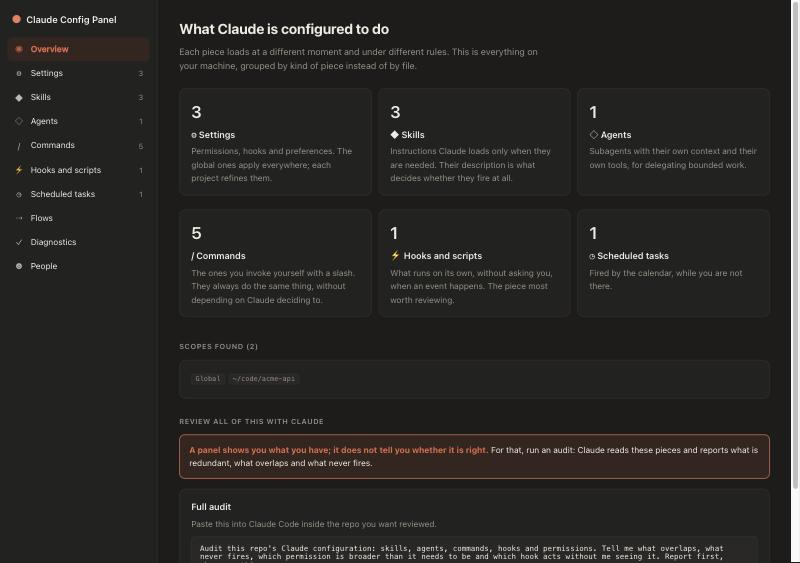
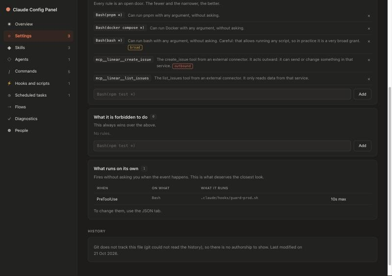
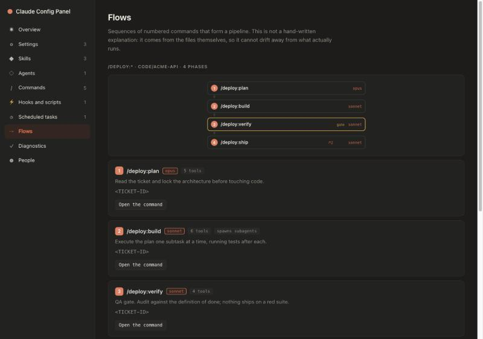
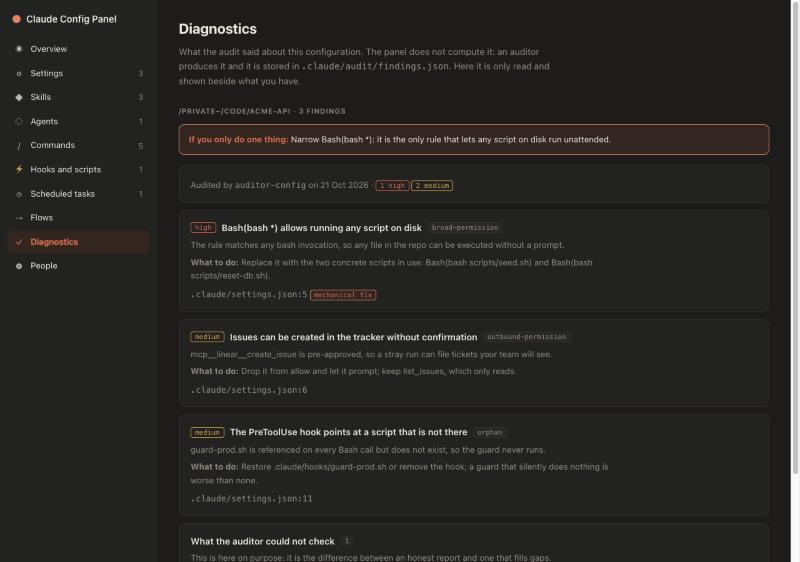

<div align="center">

# Claude Config Panel

**See everything Claude Code is configured to do — and what runs on its own.**

Your Claude setup is scattered across `~/.claude` and a `.claude/` folder in every repo.
There is no single screen that shows you all of it. This is that screen.

[](https://github.com/Galan9999/claude-config-panel/actions/workflows/ci.yml)
[](LICENSE)
[](package.json)
[](package.json)
[](test)

</div>

```bash
npx claude-config-panel
```

Open <http://127.0.0.1:7337>. Node 18+. Nothing to install, no dependencies, runs only on your machine.

<div align="center">
  
</div>

---

## Why

`/config` and `/permissions` cover a slice of it, and only in the terminal. Everything else means
opening JSON files by hand. So three questions stay unanswered:

- **What do I actually have?** Settings, skills, agents, commands, hooks and scheduled tasks, global
  and per repo, in one place.
- **What does this rule really allow?** `Bash(node *)` reads as harmless. It lets Claude run any
  script on your machine.
- **What runs without me?** Hooks and scheduled tasks act while you are not looking. That is the part
  of your configuration that deserves the most attention and gets the least.

---

## What it does

### Explains every permission in plain words

Each rule is translated, and the ones that are wider than they look get flagged.

| Rule | What the panel says |
|---|---|
| `Bash(git *)` | Can run git with any argument, without asking. |
| `Bash(node *)` | …**Careful: that allows running any script**, so in practice it is a very broad grant. → `broad` |
| `mcp__…__slack_send_message` | Acts outward: can send or change something in that service. → `outbound` |

<div align="center">
  
</div>

### Surfaces what runs on its own

Hooks and scheduled tasks in one table: what triggers them, what they run, with what time limit.
This is how you find out you have two Prettier hooks firing on every single write.

### Draws your command pipelines

Nothing to declare or install: it is a naming convention. **Two or more files in the same commands
folder whose name starts with `<number>.`** are read as the phases of one process. The number only
sets the order — they need not be consecutive nor start at 1, so you can leave gaps for phases you
add later.

```
.claude/commands/deploy/
  1.check.md
  2.build.md
  3.ship.md
```

That is enough for the panel to render `/deploy:*` as an SVG diagram generated from the files
themselves — no Mermaid, no CDN — showing each phase's model, which subagents it spawns, and **how
many actions it can take outside your machine without asking**. No folder is hardcoded; it works
with whatever you name yours.

If your commands are not a sequence, the section tells you so and explains the convention. It never
invents a flow that is not there.

<div align="center">
  
</div>

It also flags **drift**: commands referenced in documentation that no longer exist, and paths
mentioned that are not there. Documentation that describes a command nobody can run is a trap, and
this finds it the day it breaks instead of months later.

### Shows who built what

Per piece: who created it and when, who touched it since, how many lines each commit changed, and a
link to the commit. There is a profile per person with everything they created and everything they
touched afterwards.

It merges the same human across identities — work email, GitHub's
`12345+user@users.noreply.github.com`, the `user@MacBook-Air.local` of an unconfigured laptop — and
shows you which identities it merged, so you can spot a bad merge instead of trusting it.

For anything outside git — `~/.claude` is not a repo, `settings.local.json` files are gitignored —
it says so instead of inventing an author from a file timestamp.

### Reads your audits, next to what they are about

Point an auditing agent at a repo, have it write `.claude/audit/findings.json`, and the panel shows
each finding beside the piece it concerns. Pieces with findings are marked in the listings, and a
finding that names a piece without living in its file is cross-referenced to it.

No automatic patches and no automatic PRs. A patch that applies itself invites you to accept it
without reading it, which is the opposite of the point.

<div align="center">
  
</div>

> The screenshots show a sample configuration, not a real one.

### Lets you edit

Markdown rendered, JSON validated, every save backed up first.

---

## Usage

```bash
npx claude-config-panel                  # scan the usual project folders
npx claude-config-panel ~/my-repos       # scan a specific folder
```

| Option | What it does |
|---|---|
| `--port <n>` | Port to listen on (default 7337) |
| `--depth <n>` | How deep to look for `.claude/` folders (default 5 — enough for `<repo>/apps/<package>`) |
| `--worktrees` | Include linked worktrees, skipped by default because they duplicate their repo's config |
| `--help` | Usage |
| `CLAUDE_CFG_ROOTS=/a:/b` | Folders to scan, via environment variable |

With no arguments it looks for projects with a `.claude/` folder in the usual places (`~/code`,
`~/dev`, `~/projects`, `~/Desktop`, `~/Documents`…). Ctrl+C to stop.

---

## Security

> [!IMPORTANT]
> This reads **and writes** your Claude configuration. Every save leaves a copy in
> `~/.claude/backups/config-dashboard/` first, but it is worth knowing before you start editing.

- **Listens on 127.0.0.1 only.** Never exposed to the network.
- **Checks where every request comes from.** Binding to localhost is not protection from your
  browser: any open website can fire requests at it. With `content-type: text/plain` that would be a
  simple request, no preflight, and the write would land even though the attacker cannot read the
  response — and the first piece in the inventory is `~/.claude/settings.json`, where a hook runs by
  itself in your next Claude session. So `Host` is validated (which also closes DNS rebinding),
  `Origin` is validated, and `application/json` is required, forcing a preflight.
  Regression tests live in [`test/server.test.mjs`](test/server.test.mjs).
- **Writes only to config files found during the scan.** Any other path is rejected.
- **Serves static files from `ui/` with no subfolders and no `..`**, so there is no path traversal.
- **Validates JSON before writing.** A malformed file never reaches disk.

Do not expose it beyond your own machine: it reads your Claude configuration, which can hold paths,
connector tokens and the contents of your scheduled tasks.

Thanks to **Lluís Filella** for catching the unauthenticated `POST`.

---

## The findings format

For an audit to be worth more than a read-through, its output needs a contract:
[`schema/findings.schema.json`](schema/findings.schema.json), validated by
[`src/findings.mjs`](src/findings.mjs).

<details>
<summary>Example <code>.claude/audit/findings.json</code></summary>

```json
{
  "version": 1,
  "generatedAt": "2026-10-21T16:40:00.000Z",
  "tool": "auditor-config",
  "scope": { "path": "~/repos/backend", "kind": "repo" },
  "summary": "Drop Bash(bash *) from allow.",
  "findings": [{
    "id": "wildcard-bash-permission",
    "severity": "alta",
    "category": "permiso-amplio",
    "title": "Bash(bash *) allows running any script",
    "path": ".claude/settings.local.json",
    "line": 4,
    "what": "The rule lets any file be executed.",
    "proposal": "Replace it with the three concrete invocations actually in use.",
    "autofix": { "kind": "quitar-permiso", "file": ".claude/settings.local.json", "rule": "Bash(bash *)" }
  }],
  "notChecked": []
}
```

</details>

Validation is strict on purpose: whatever produces this is a language model or a third-party tool.
Two rules that are not cosmetic:

- **`id` must be stable across audits.** That is what decides whether a finding opens a new ticket or
  already has one.
- **A `proposal` starting with "review" is rejected.** It has to say what to do.

The format does not depend on this panel. Any auditor can emit it, and `cc-audit --format json` is a
candidate for an adapter.

---

## Development

No dependencies, runtime or dev. Everything it uses ships with Node: the server is `node:http` and
the tests are `node:test`.

```bash
git clone https://github.com/Galan9999/claude-config-panel
cd claude-config-panel
npm start      # run the panel
npm test       # 100 tests
```

<details>
<summary>Project layout</summary>

```
bin/claude-config-panel.mjs   CLI entry point
src/
  cli.mjs        Arguments, help, startup message
  paths.mjs      ~/.claude paths
  fsutil.mjs     Tolerant reads, frontmatter, script docs
  git.mjs        GitHub remote, repo root, worktree detection
  history.mjs    Authorship and changes, via git log
  flows.mjs      Numbered command pipelines and drift detection
  findings.mjs   Audit findings schema and cross-referencing
  discover.mjs   Filesystem walk and piece catalogue
  server.mjs     HTTP routes, saving, backups
ui/
  index.html     The page
  style.css      Palette, with dark mode
  app.js         Navigation, listings, detail, editing
  markdown.js    Markdown renderer
  permissions.js Translates a permission rule into a sentence
  util.js        HTML escaping and helpers
test/            Tests for the pure functions and the HTTP contract
```

</details>

The interface lives in real `.html`, `.css` and `.js` files served as static assets.
`ui/markdown.js` and `ui/permissions.js` are DOM-free ES modules, so the Node tests import exactly
the same code the browser runs.

---

## License

MIT
